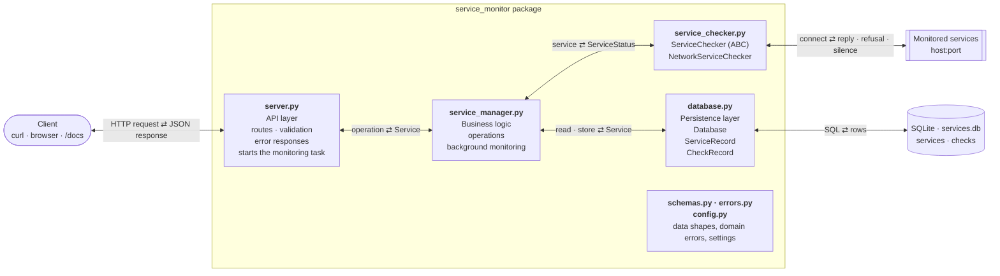
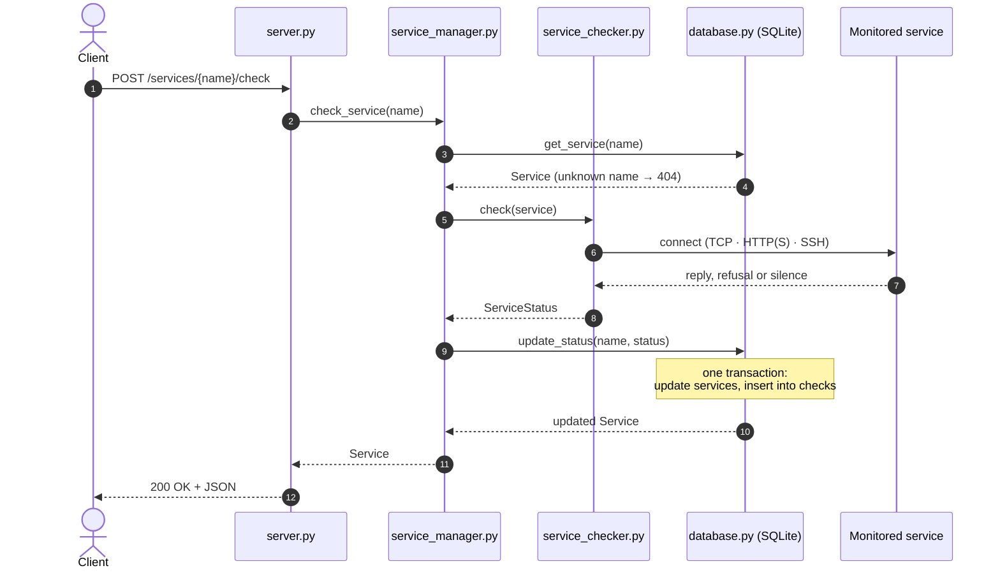

# Service Monitoring API

A small REST API that keeps a list of network services and checks whether each one is reachable.
A check can be a plain TCP connection, an HTTP or HTTPS request, or an SSH handshake greeting.
Services, their latest status and the history of every check are stored in a local SQLite database, so they survive a restart.
A background task re-checks every service periodically, and all checks run concurrently.

## Setup

Requirements: Python 3.12+ and [uv](https://docs.astral.sh/uv/getting-started/installation/).

```bash
git clone https://github.com/TomerGross/lab42-home-exercise.git
cd lab42-home-exercise
uv sync
```

## Run

```bash
uv run uvicorn service_monitor.server:app
```

The API listens on `http://127.0.0.1:8000`. Interactive documentation is at `http://127.0.0.1:8000/docs`.

Optional environment variables (invalid values stop the server at startup with a clear message):

| Variable | Default | Meaning |
|---|---|---|
| `DATABASE_URL` | `sqlite+aiosqlite:///./services.db` | Where data is stored (a `services.db` file in the current directory) |
| `CHECK_TIMEOUT_SECONDS` | `3.0` | How long one check may take before it is reported as a timeout |
| `MONITOR_INTERVAL_SECONDS` | `60.0` | Pause between background monitoring rounds. The first round runs one interval after startup |

## API

Every service is returned in this shape:

```json
{
  "name": "Service A",
  "host": "127.0.0.1",
  "port": 8001,
  "check_type": "tcp",
  "status": "UP",
  "last_checked": "2026-10-22T16:24:24Z",
  "response_time_ms": 0.58,
  "failure_reason": null
}
```

`status` is `UP`, `DOWN` or `UNKNOWN`. `UNKNOWN` means the service was added but has not been checked yet; `last_checked` is then `null`.
`last_checked` is in UTC.
`response_time_ms` is set when the service is UP, otherwise `null`. `failure_reason` is set when it is DOWN, otherwise `null`.

### Check types

`check_type` is optional when adding a service and defaults to `tcp`.

| `check_type` | The service is UP when… |
|---|---|
| `tcp` | a TCP connection to `host:port` opens |
| `http` | `GET /` answers with any status below 500 (redirects are not followed; a 3xx or 4xx still proves a working web server) |
| `https` | the same as `http`, over TLS with the certificate verified |
| `ssh` | the server greets with an SSH identification line (`SSH-2.0-…`). No login is attempted |

Every check, including the reply, must finish within `CHECK_TIMEOUT_SECONDS`.

### Add services: `POST /services`

```bash
curl -X POST http://127.0.0.1:8000/services \
  -H "Content-Type: application/json" \
  -d '{"services": [{"name": "Service A", "host": "127.0.0.1", "port": 8001},
                    {"name": "Web", "host": "example.com", "port": 443, "check_type": "https"}]}'
```

Returns `201 Created` with the added services, all with status `UNKNOWN`.
The request is all-or-nothing: if any service is invalid or a duplicate, none are added.

Validation rules:
- `name`: 1–100 characters, no `/` (it is used in the URL).
- `host`: an IPv4/IPv6 address or a hostname (letters, digits, hyphens, dots). URLs such as `http://x.com` are rejected.
- `port`: an integer from 1 to 65535.
- `check_type` (optional): `tcp` (the default), `http`, `https` or `ssh`. Any other value is rejected.
- Any other field, for example `"protocol": "tcp"`, is rejected.

A service that breaks a rule is rejected with `422`, and `detail` names the field (for example `services.0.host`).

### List services: `GET /services`

```bash
curl http://127.0.0.1:8000/services
```

Returns `200 OK` with all services and their latest status, sorted by name.

### Get a service: `GET /services/{name}`

```bash
curl "http://127.0.0.1:8000/services/Service%20A"
```

Returns `200 OK` with the service, or `404` if no service has that name.

### Check a service: `POST /services/{name}/check`

```bash
curl -X POST "http://127.0.0.1:8000/services/Service%20A/check"
```

Runs a check now, stores the result as the service's latest status and in its history, and returns `200 OK` with the updated service.
A service that is DOWN is still a successful check, so it also returns `200`. The reason  is in `failure_reason`:

| `failure_reason` | Meaning |
|---|---|
| `timeout` | No complete answer within `CHECK_TIMEOUT_SECONDS` |
| `connection_refused` | The host answered, but nothing listens on that port |
| `unreachable` | No network route to the host |
| `dns_error` | The hostname could not be resolved |
| `unexpected_response` | Connected, but the reply did not match the check type: an HTTP 5xx, a reply that is not HTTP, or no SSH greeting |
| `other` | Any other connection error, for example an invalid TLS certificate |

### Check several services: `POST /services/check`

```bash
curl -X POST http://127.0.0.1:8000/services/check \
  -H "Content-Type: application/json" -d '{"names": ["Service A", "Web"]}'
curl -X POST http://127.0.0.1:8000/services/check          # no body: check every service
```

Checks the named services (or all of them) concurrently and returns `200 OK` with each updated service, sorted by name.
If any name is unknown, nothing is checked and `404` is returned. An empty `names` list is rejected with `422`.

### Delete a service: `DELETE /services/{name}`

```bash
curl -X DELETE "http://127.0.0.1:8000/services/Service%20A"
```

Deletes the service and its history and returns `204 No Content`, or `404` if no service has that name.

### Monitoring history: `GET /services/{name}/history`

```bash
curl "http://127.0.0.1:8000/services/Service%20A/history?limit=10"
```

Returns `200 OK` with the service's past checks, newest first: a list of `{status, last_checked, response_time_ms, failure_reason}`.
`limit` defaults to 100 and must be between 1 and 1000. A service that was never checked returns `[]`.

### Errors

Every error has the same shape: a stable `error` code for programs and a `detail` for people.

```json
{"error": "unknown_service", "detail": "Unknown service: 'Service X'"}
```

| Status | `error` | When |
|---|---|---|
| 404 | `unknown_service` | No service has that name |
| 409 | `duplicate_service` | A service with the same name or the same `host:port` already exists, or appears twice in the request |
| 422 | `invalid_request` | Malformed JSON, a missing or empty list, an invalid or unknown field, or `limit` out of range. `detail` lists each problem as `{"field", "message"}` |
| 404 / 405 | `not_found` / `method_not_allowed` | Unknown URL or HTTP method |
| 500 | `internal_error` | Unexpected server error. The details are logged, never sent to the client |

## Testing

```bash
uv run pytest
uvx ruff check .            # lint
uvx ruff format --check .   # formatting
```

| File | Covers |
|---|---|
| `tests/test_schemas.py` | Input validation: names, hosts, ports, check types, unknown fields |
| `tests/test_service_checker.py` | Every check type against small local fake servers, and how each failure maps to a `failure_reason` |
| `tests/test_database.py` | Storing, reading and updating services, duplicates, history, deletes, data surviving a restart |
| `tests/test_service_manager.py` | The business operations, the concurrency limit and the background monitoring loop, with fake checkers |
| `tests/test_server.py` | The API end to end: status codes, error bodies, JSON field order, background monitoring, persistence across an app restart |
| `tests/test_config.py` | Settings defaults, environment overrides and rejected values |

The tests need no internet and no running services. They start everything they need themselves:

- **Fake servers for the checker.** A test starts a tiny `asyncio` TCP server on a free localhost port (the OS picks one).
  It answers every connection with a fixed reply chosen by the test: an HTTP response such as `HTTP/1.1 200 OK` or `503`, an SSH greeting (`SSH-2.0-…`), bytes that are neither, or nothing at all.
  This tests each check type against a working server and against each kind of broken one, without installing a web or SSH server.
  A refused connection is tested against a port that was just freed, so nothing listens on it.
- **Simulated errors.** A connection that never opens (timeout), an unreachable network and a DNS failure cannot be produced reliably on localhost.
  For those, the test replaces `asyncio.open_connection` (with pytest's `monkeypatch`) by a function that hangs or raises that error.
- **A fresh database for each test.** Each test gets its own SQLite file in a temporary directory (pytest's `tmp_path`), deleted after the run.
  Tests never share data and never touch `services.db`. The restart tests close the app and open a new one on the same file.
- **Fake checkers for the business logic.** `ServiceManager` receives its checker in the constructor, so its tests pass small `ServiceChecker` classes that answer without any network:
  one always reports UP, one records how many checks run at the same time (the concurrency limit), and one fails once (the monitoring loop keeps running).
- **The API end to end.** The server tests send real HTTP requests to the app through FastAPI's `TestClient`, with the real checker, a temporary database, a short timeout and a short monitoring interval.

## Architecture

The diagram shows the components and what passes between them in each direction: each label reads "what goes there ⇄ what comes back".
It is also available as an image: [architecture_diagram.png](architecture_diagram.png).



| Module | Responsibility |
|---|---|
| `server.py` | The FastAPI app: routes, request validation and turning errors into JSON responses. Its lifespan opens the database and starts and stops the background monitoring task. The only module that knows the web framework. |
| `service_manager.py` | Business logic: the API operations, concurrent checks, at most 100 at a time, and the background monitoring loop. Receives its database and checker in the constructor. |
| `service_checker.py` | `ServiceChecker` is the abstract contract. `NetworkServiceChecker` runs the check that matches the service's `check_type` and measures how long it takes. It never raises on network failures. |
| `database.py` | The `services` table (configuration and latest status) and the `checks` table (history), and the `Database` class that reads and writes them. The only module that knows SQL. |
| `schemas.py` | Pydantic models shared by all layers: `ServiceConfig` (client input), `ServiceStatus` (one check result) and `Service` (both). |
| `errors.py` | Domain errors (`UnknownServiceError`, `DuplicateServiceError`), each declaring its HTTP status and error code. |
| `config.py` | `Settings`: the three settings above, read from environment variables and validated. |

### How a check flows

This diagram follows one `POST /services/{name}/check` from the request to the response.
Solid arrows are calls and dashed arrows are the values they return.



1. The client sends `POST /services/{name}/check`.
2. `server.py` calls `ServiceManager.check_service(name)`.
3. The manager asks the `Database` for the service.
4. The `Database` returns it, or nothing for an unknown name. The manager then raises `UnknownServiceError`, which the server returns as `404`.
5. The manager passes the service to `NetworkServiceChecker.check`.
6. The checker connects to `host:port` with the service's check type: TCP, HTTP(S) or SSH.
7. The monitored service replies, refuses the connection, or stays silent until `CHECK_TIMEOUT_SECONDS` runs out.
8. The checker returns a `ServiceStatus` to the manager: UP with `response_time_ms`, or DOWN with `failure_reason`. It never raises on a network failure.
9. The manager calls `Database.update_status`, which updates the service's row in `services` and adds a row to `checks`, in one transaction.
10. The `Database` returns the updated `Service`.
11. The manager returns it to the server.
12. The server sends it to the client as JSON with `200 OK`.

The checker never talks to the database: the manager stores its result.
The background task, started by the server at startup, reads every service and runs steps 5–10 for each, every `MONITOR_INTERVAL_SECONDS`.
The other endpoints take the same path without the checker: server → manager → database.

## Design decisions

- **FastAPI with async I/O.** A check spends almost all its time waiting on the network. With asyncio, the server keeps answering requests while checks wait, and many checks can wait at the same time.
- **SQLite through async SQLAlchemy.** SQLite needs no installation and stores everything in one local file. SQLAlchemy keeps the SQL in one module, so moving to PostgreSQL should mostly mean changing `DATABASE_URL` and adding a PostgreSQL driver package such as `asyncpg` (not tested).
- **Current state plus an event log.** The `services` table holds each service's latest status, so listing services stays one fast read. The `checks` table records every check. Both are written in one transaction, so they never disagree.
- **Shared Pydantic models, separate tables.** The API, the business logic and the checker use the same `schemas.py` types. The database has its own table classes, so storage can change without changing the API.
- **A duplicate is the same name or the same `host:port`.** Two entries for one `host:port` would probe the same endpoint twice, and one could show UP while the other shows DOWN only because they were checked at different moments. Both rules are unique constraints in the database, so they also hold under concurrent requests.
- **`POST /services` is all-or-nothing.** All services are inserted in one transaction. A client never has to find out which half of its request was saved.
- **A DOWN service is not an HTTP error.** The check itself succeeded; its result is DOWN. HTTP error codes are kept for problems with the request.
- **The checker never raises on network failures.** Every failure becomes a DOWN status with a `failure_reason`, so one failing service cannot break another check, a monitoring round or the server.
- **One checker for every check type.** HTTP(S) and SSH run over TCP too, so `NetworkServiceChecker` shares the timing, timeout and failure handling and only the protocol step differs. HTTP uses `httpx2` (async, so it does not block the server). SSH only reads the server's greeting, so no SSH library or credentials are needed.
- **Concurrency with a limit.** Checking many services runs them together with `asyncio.gather`, so the total time is about that of the slowest check. A semaphore allows at most 100 checks at once, so a long list cannot run out of sockets and report healthy services as DOWN.
- **Monitoring runs inside the server process.** There is no separate worker or scheduler to deploy; it starts and stops with the server.

## Limitations

- No authentication: anyone who can reach the API can add, check and delete services.
- History grows without limit: at the default interval that is 1,440 rows per service per day. Deleting checks older than a retention period would be the fix.
- Services cannot be edited; delete and add them again instead.
- A `tcp` check proves only that the port accepts connections: the OS completes the handshake even when the application is frozen. Use `http` or `ssh` to require an answer.
- HTTP(S) checks request `/` only. HTTPS requires a valid certificate, so a self-signed one reports DOWN.
- One service per `host:port`, whatever its check type. `localhost` and `127.0.0.1` count as different hosts.
- `response_time_ms` includes the DNS lookup for hostnames, and for HTTP(S) the time until the response headers arrive.
- There are no migrations: tables are created at startup. After a schema change, an older `services.db` must be deleted.
- A service deleted while its check is running makes that check, or a whole multi-service check, fail with `404` (rarely `500`). A monitoring round that hits this is logged and the next round runs normally.
- Settings are read from the environment, so a `DATABASE_URL` set for another project in the same shell is picked up.
- SQLite handles one write at a time, and each check result is one write. Around a thousand services, when many checks finish at once, the last writes in line can exceed SQLite's 5-second wait and fail with `database is locked`: that multi-service check returns `500` (the other results are still stored), or that monitoring round is logged as failed. Saving a round's results together in one transaction, instead of one by one, or moving to PostgreSQL, would fix it.
- Run a single server process. With `--workers N`, each worker starts its own monitoring loop, so every service is checked N times per round, and the workers compete for SQLite, which allows one writer at a time.
